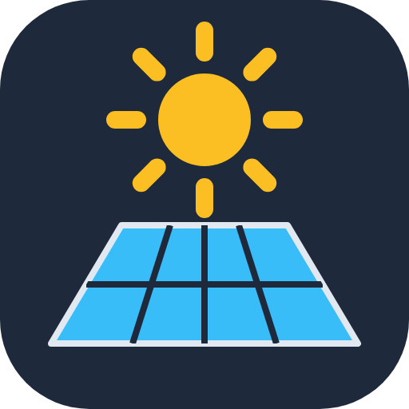
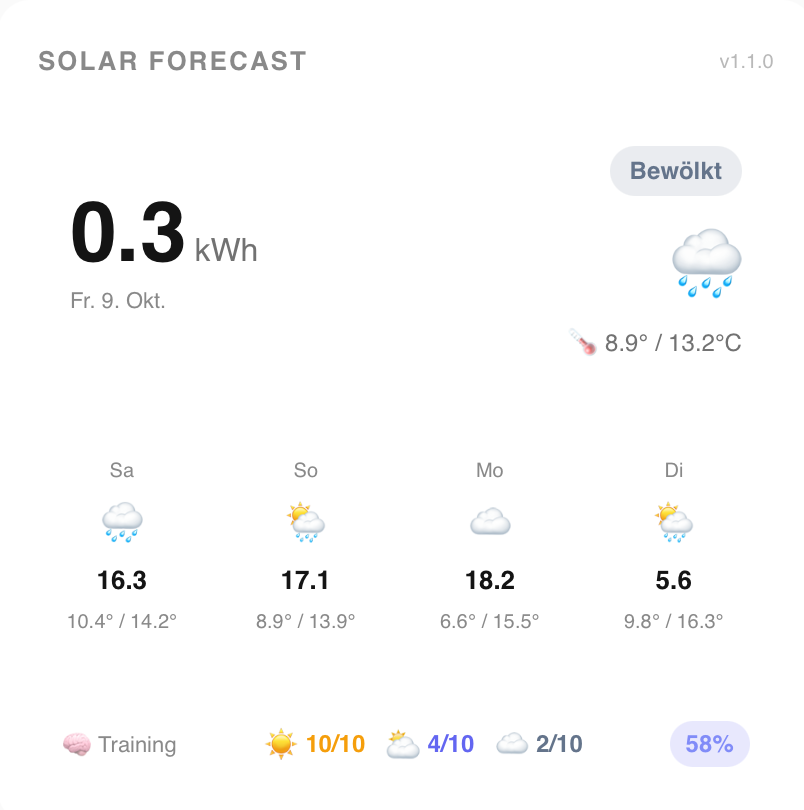

<p align="center"></p>

# Solar Forecast – Solar Yield Forecasting for Home Assistant

A custom integration, available in the Home Assistant Marketplace and in HACS, that predicts your daily solar panel energy production using a self-learning ML model trained automatically from your Home Assistant Energy Dashboard data — with a built-in Lovelace card, no separate frontend install required.

📖 Blog post (German): [PV-Prognose in Home Assistant mit Solar Forecast](https://itrend24.de/pv-prognose-home-assistant-solar-forecast/)

<p align="center"></p>

## Features

- **Solar yield forecast** (kWh per day, up to 8 days ahead)
- **Hourly forecast** – the day's total spread over its hours, learned per sun position (shade from trees, houses or the horizon), with sensors for power now, the strongest hour and the best 2/3-hour window
- **No roof data needed** – the orientation of your panels is detected from your own hourly yields
- **Energy Dashboard** – can be chosen as the solar production forecast, like Forecast.Solar
- **Automatic ML training** – reads your actual solar production from the HA Energy Dashboard, no manual input needed
- **Weather-bucketed learning** – separate efficiency curves for sunny, mixed, and overcast days
- **Temperature compensation** – accounts for panel efficiency loss at high temperatures
- **20 HA sensor entities** – usable in automations, dashboards, and Energy cards
- **Built-in Lovelace card** – bundled with the integration and auto-registered as a frontend resource, no separate card install needed
- **Fully configurable via HA UI** – no YAML needed

## Requirements

- Home Assistant 2024.7 or newer
- A solar energy sensor with `device_class: energy` and `state_class: total_increasing` or `total` (e.g. from a Fronius, SMA, Huawei, or Shelly inverter integration)
- Home Assistant 2026.11 or newer: nothing else, the Marketplace is built in. Older versions: HACS

## Installation

The Lovelace card ships with the integration and registers itself automatically, so no separate frontend/plugin install is needed. If the card isn't offered right after installing, reload your browser.

### Via the Marketplace (Home Assistant 2026.11 or newer, recommended)

Since 2026.11, HACS is built into Home Assistant as the [Marketplace](https://www.home-assistant.io/integrations/marketplace/). No GitHub account is needed.

1. Go to **Settings → Marketplace**
2. Search for **Solar Forecast** and select **Install**. The first time, you need to accept the Marketplace's notice about community projects
3. Home Assistant opens the setup wizard directly, without a restart. Continue with step 3 under [Setup](#setup)

Updates still need a restart. If you used HACS before 2026.11, Home Assistant migrates it automatically: Solar Forecast stays installed and keeps receiving updates.

### Via HACS (Home Assistant before 2026.11)

1. Open HACS in Home Assistant
2. Search for **Solar Forecast** and download it
3. Restart Home Assistant

## Setup

1. Go to **Settings → Devices & Services → Add Integration**
2. Search for **Solar Forecast**
3. Follow the setup wizard:
   - Choose your location (HA home coordinates or city search)
   - Select your solar energy sensor from the dropdown — pre-filled from your [Energy Dashboard](https://www.home-assistant.io/home-energy-management/)'s configured solar source when available, so there's usually nothing to change here

The sensor must be an energy sensor with state class `total` or `total_increasing`, because the yield is read from Home Assistant's long-term statistics. Lifetime totals work with either. Sensors that reset daily (e.g. "PV daily yield") work with `total_increasing`, or with `total` if the sensor also updates `last_reset`. Without `last_reset`, the statistics count the midnight reset as a drop and those days are wrong. After setup, the model trains automatically within the first update cycle.

## Sensors Created

The entity IDs start with your location name, e.g. `sensor.home_solar_forecast_today` for a location called "Home". The table shows them without that prefix:

| Entity | Unit | Description |
|--------|------|-------------|
| `…_solar_forecast_today` | kWh | Forecasted yield today |
| `…_solar_forecast_tomorrow` | kWh | Forecasted yield tomorrow |
| `…_solar_forecast_day_3` … `_day_8` | kWh | Days +2 to +7 |
| `…_solar_forecast_model_accuracy` | % | Training completeness, not forecast error: real training days of 30, plus a bonus once sunny, mixed and overcast days are all known (see below) |
| `…_solar_forecast_training_count` | — | Number of real training data points |
| `…_solar_forecast_today_condition` | — | Weather bucket: sunny / mixed / overcast |
| `…_solar_forecast_power_now` | W | Expected power right now. Attributes show the orientation in use (`orientation_source`, `tilt`, `azimuth`) |
| `…_solar_forecast_energy_current_hour` | kWh | Expected energy in the current clock hour (newest forecast; frozen once the hour has begun) |
| `…_solar_forecast_energy_next_hour` | kWh | Expected energy in the next clock hour |
| `…_solar_forecast_current_hour_morning_forecast` | kWh | This hour's energy as forecast in the morning (from 06:00). Kept as a long-term statistic, to compare with your real yield |
| `…_solar_forecast_remaining_today` | kWh | Expected energy from now until midnight. Equals today's forecast before sunrise, then falls during the day |
| `…_solar_forecast_peak_time_today` / `_tomorrow` | time | Start of the strongest hour (attribute `energy_kwh`) |
| `…_solar_forecast_best_2h_window` / `_best_3h_window` | time | Start of the best 2 or 3 hours still ahead today, else tomorrow – handy for the washing machine or dishwasher (attributes `end`, `energy_kwh`) |

Each forecast sensor includes attributes: `date`, `weather_code`, `radiation_mj_m2`, `temp_max_c`, `temp_min_c`, `condition`, `sunrise`, `sunset`, and `hourly` (list of `{start, kwh}` for that day; not stored in the database).

### Energy Dashboard

Go to **Settings → Dashboards → Energy**, edit your solar production source and select this Solar Forecast entry under *Solar production forecast*. Pick only one forecast there: if you select several, Home Assistant adds their curves up.

## The Lovelace Card

The card auto-discovers your Solar Forecast sensors. Just add it to your dashboard:

```yaml
type: custom:solarforecast-card
title: Solar Forecast  # optional
```

The visual card editor only exposes the title, since sensors are auto-discovered and there is realistically only one instance per install. If you run multiple instances, override individual sensors in YAML (via the card's code editor):

```yaml
type: custom:solarforecast-card
title: Solar Forecast
entity_today: sensor.home_solar_forecast_today
entity_tomorrow: sensor.home_solar_forecast_tomorrow
entity_day3: sensor.home_solar_forecast_day_3
entity_day4: sensor.home_solar_forecast_day_4
entity_accuracy: sensor.home_solar_forecast_model_accuracy
entity_training: sensor.home_solar_forecast_training_count
entity_condition: sensor.home_solar_forecast_today_condition
```

Displays: today's yield, weather condition and temperature; a 4-day forecast strip; and a compact ML training overview (Sunny / Mixed / Overcast · Accuracy).

## How the ML Model Works

The model classifies each day into one of three weather buckets based on the **clear-sky ratio** (sunshine hours / daylight hours):

| Bucket | Ratio | Behaviour |
|--------|-------|-----------|
| ☀️ Sunny | ≥ 0.70 | Direct irradiation dominant |
| ⛅ Mixed | 0.30 – 0.69 | Variable conditions |
| ☁️ Overcast | < 0.30 | Diffuse irradiation |

For each bucket, it learns an **optical efficiency index** from your actual yield data:

```
optical_index = (yield_kwh / radiation) / temperature_penalty
expected_yield = radiation_forecast × optical_index × temperature_penalty
```

Newer data is weighted 10× more than older data (linear weighting from 10 down to 1). On the very first real observation, the other two buckets are auto-filled from physical efficiency ratios (sunny=1.0, mixed=0.88, overcast=0.75) so forecasts work immediately for any weather. Each bucket keeps at most 10 real entries (30 total); the model becomes reliable after ~10–15 real observations (a few weeks of data).

**Temperature compensation** accounts for panel efficiency loss: cells typically run ~10°C warmer than air temperature, losing ~0.4% efficiency per degree above 25°C (STC reference).

**Model accuracy** reflects training completeness, not prediction error: up to 90% from the number of real training days (of a 30-day cap), plus up to +10% bonus once all three weather buckets have real data.

## How the Hourly Forecast Works

1. Open-Meteo provides the global, direct and diffuse irradiance for every hour. The integration computes the irradiance on your panels from them.
   - **Orientation is detected automatically.** Once a day the integration tries tilts from 0–70° and directions from east over south to west and keeps the one whose daily shape fits your own hourly yields of the last 60 days best. Shade shifts the result: a roof with shade in the afternoon is detected as facing further east. That is intended, it is the orientation your system *behaves* like. With fewer than 10 days of usable data, or when no orientation fits clearly better, the horizontal irradiance is used.
   - **Tilt and azimuth** in the options (gear icon) are optional and override the detection.
   - The `Power Now` sensor shows the orientation in use (`orientation_source`: detected, manual or horizontal; `tilt`, `azimuth`).
2. From your recorder's hourly statistics, the integration learns how your system really behaves at each **sun position** (15° of azimuth × elevation band), compared with the irradiance of the same hours. Shade is tied to the sun's position, so what is learned in one season carries over. Newer hours count more (half weight after 45 days); bins with little data lean towards the overall average. On first start the last 60 days are learned at once.
3. The learned shape spreads each day's forecast total over its hours.
4. **Honest past:** the forecast is updated every hour, but an hour that has begun keeps the value it was forecast with before it began. The Energy Dashboard therefore shows how good the forecast really was, not a curve redrawn afterwards. The daily sensors always show the newest forecast for the whole day, so during the day they can differ from the sum of the hours.

**Learn from date** (options): yields before this date are ignored – useful after shade was removed or the system was extended. Daily training days before this date are removed for good, so *Model accuracy* drops until new days are learned.

## Data Sources

- **Weather forecast**: [Open-Meteo](https://open-meteo.com/) – free, no API key required (about 25–30 requests per day, updated hourly)
- **Solar production**: Your HA recorder / Energy Dashboard (local data, no cloud)

## History

This project merges what used to be two separate repositories (`solarindex-ha` integration + `solarindex-card` frontend card) into a single, self-contained integration.

## Support

SolarForecast is free and stays free. If it is useful to you and you would like to support the project, I'd appreciate a coffee: [paypal.me/itrend24](https://www.paypal.me/itrend24)
